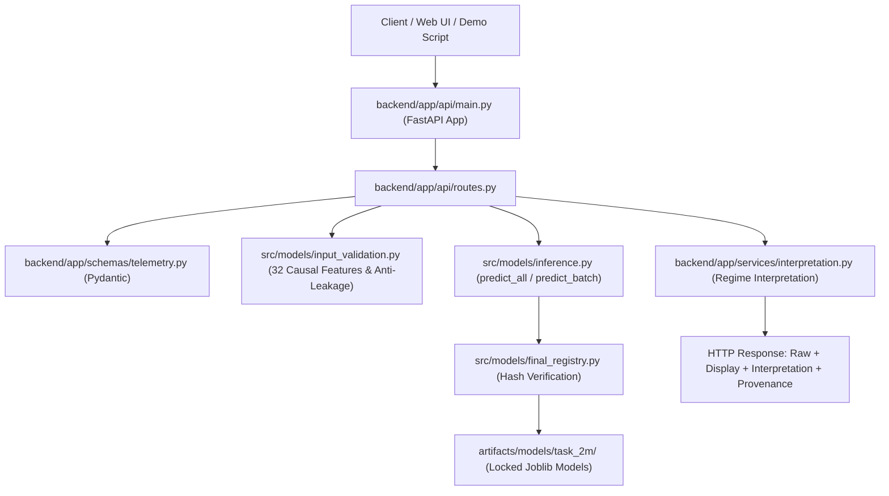

# EcoCycle AI — Task 2N: Production Inference API & Application Integration
## Implementation Plan

**Document ID:** ECOCYCLE-PLAN-TASK-2N-API-INTEGRATION-001  
**Pipeline Stage:** Task 2N — Production Inference API & Application Integration  
**Date:** 2026-09-07  
**Author:** EcoCycle AI Engineering Team  
**Status:** **PROPOSED — AWAITING EXPLICIT APPROVAL**  

---

## 1. Executive Summary & Objective

The objective of **Task 2N** is to build a robust, professional, and defensible application/integration layer on top of the certified Task 2M.4 inference pipeline. This layer will expose the certified final models (`soh_xgboost_32f` and `rul_catboost_32f`) via a RESTful FastAPI service and standalone demonstration interface.

This integration is designed as a high-rigor MCA capstone and technical placement showcase:
- **Strict Non-Destructive Invariants:** Zero model retraining, zero hyperparameter adjustment, zero modifications to model binaries or SHA-256 hashes, and read-only protection of `master_dataset.csv`.
- **Dual Output Architecture:** Authoritative raw predictions are strictly preserved; presentation-layer bounds (e.g. non-negative RUL, $[0, 100\%]$ SOH) are formatted in a separate display structure.
- **Rule-Based Interpretation:** Grounded strictly in previously verified degradation regimes from Tasks 2L.3 and 2N, labeled explicitly as presentation/business rules.
- **Zero-Leakage API Contract:** Rejects forbidden features (`QDischarge`, `max_cycle`, cross-target labels) with explicit HTTP error responses.

---

## 2. Existing Architecture & Repository Inspection

An inspection of the EcoCycle AI codebase revealed:
1. **Certified Inference Pipeline:**
   - [`src/models/feature_schema.py`](file:///C:/Users/patid/.gemini/antigravity/scratch/EcoCycle-AI/src/models/feature_schema.py): Canonical 32 causal features, 6 feature groups, forbidden leakage registry, and physical admissibility bounds.
   - [`src/models/final_registry.py`](file:///C:/Users/patid/.gemini/antigravity/scratch/EcoCycle-AI/src/models/final_registry.py): Centralized model registry manager verifying physical artifact hashes on disk.
   - [`src/models/input_validation.py`](file:///C:/Users/patid/.gemini/antigravity/scratch/EcoCycle-AI/src/models/input_validation.py): Enforces feature completeness, NaN/Inf rejection, and anti-leakage guards.
   - [`src/models/inference.py`](file:///C:/Users/patid/.gemini/antigravity/scratch/EcoCycle-AI/src/models/inference.py): Production inference functions (`predict_soh`, `predict_rul`, `predict_all`, `predict_batch`, `format_presentation_output`).
2. **Backend Scaffolding:**
   - `backend/app/api`, `backend/app/core`, `backend/app/schemas`, `backend/app/services` directories exist.
   - [`Dockerfile`](file:///C:/Users/patid/.gemini/antigravity/scratch/EcoCycle-AI/Dockerfile) and [`docker-compose.yml`](file:///C:/Users/patid/.gemini/antigravity/scratch/EcoCycle-AI/docker-compose.yml) explicitly configure `backend.app.api.main:app` as the backend application entrypoint.
3. **Environment & Dependencies:**
   - FastAPI (`0.136.3`), Pydantic (`2.13.4`), Uvicorn (`0.28.0+`), and Pytest (`9.1.1`) are installed and verified.
4. **Certified Model Binaries:**
   - SOH: `artifacts/models/task_2m/soh/xgboost_32f.joblib` (SHA-256: `f5dbd8339e1a81c61806edbac127cd289b940e0c9654211383f750704d7614d1`)
   - RUL: `artifacts/models/task_2m/rul/catboost_32f.joblib` (SHA-256: `67ecc6e5767ab4c6306fd02cc0bcf9d6ebc9c2baad990ba5d4097ab74bf4d0dc`)

---

## 3. Integration Architecture

---

## 4. Detailed Component Plan

### 4.1 Files to be Created

1. **`backend/app/api/main.py`**:
   - Initializes FastAPI application (`title="EcoCycle AI Battery Health API"`, `version="1.0.0"`).
   - Configures CORS middleware for frontend compatibility.
   - Adds custom exception handlers for `InputValidationError` (HTTP 400) and `DataLeakageError` (HTTP 422).
   - Includes application router from `routes.py`.

2. **`backend/app/api/routes.py`**:
   - `GET /health`: Health status, model loading check, and system uptime.
   - `GET /model-info`: Comprehensive model provenance, framework versions, dataset SHA-256, validation and test metrics.
   - `POST /predict`: Single battery-cycle telemetry record inference. Returns raw predictions, display predictions, interpretation, and provenance.
   - `POST /predict/batch`: Batch telemetry records inference. Maximum batch size capped at 5,000 records. Preserves metadata (`battery_id`, `row_id`).

3. **`backend/app/schemas/telemetry.py`**:
   - Pydantic models for request validation and response serialization:
     - `BatteryCycleTelemetry`: Input schema defining 32 causal features and optional metadata (`battery_id`, `row_id`).
     - `BatchTelemetryRequest`: List of telemetry records with batch size validation.
     - `PredictionDetail`: Sub-schema for raw and display values.
     - `InterpretationDetail`: Sub-schema for degradation category, confidence/caveats, and business rules.
     - `PredictionResponse`: Single record response schema.
     - `BatchPredictionResponse`: Batch records response schema.
     - `ModelInfoResponse`: Service and model provenance schema.

4. **`backend/app/services/interpretation.py`**:
   - Deterministic, rule-based interpretation module mapping predictions to established project regimes:
     - **SOH Regimes:**
       - $\text{SOH} \ge 90\%$: `Healthy` — Normal operational state.
       - $80\% \le \text{SOH} < 90\%$: `Degraded` — Accelerated aging surveillance recommended.
       - $\text{SOH} < 80\%$: `Critical Knee` — End-of-first-life threshold reached; retire or repurpose.
     - **RUL Regimes:**
       - $\text{RUL} \ge 800$ cycles: `Long Remaining Life` — Early operating lifecycle.
       - $300 \le \text{RUL} < 800$ cycles: `Moderate Remaining Life` — Mid-life operational regime.
       - $\text{RUL} < 300$ cycles: `Near End-of-Life` — Close surveillance; schedule second-life repurposing.
   - Explicit disclaimer: *"Presentation interpretation rule based on Task 2L.3 degradation regimes; not an industrial warranty."*

5. **`scripts/demo_inference.py`**:
   - Standalone demonstration script showing end-to-end API and inference capabilities:
     1. Loads certified inference engine.
     2. Scores synthetic healthy and degraded battery cycle records.
     3. Demonstrates raw vs display output preservation.
     4. Demonstrates rejection of missing features and NaNs.
     5. Demonstrates active leakage protection against `QDischarge` and `max_cycle`.

6. **`reports/modeling/task_2n/api_contract.md`**:
   - Formal OpenAPI and REST contract documentation, endpoint signatures, schemas, error codes, and sample payloads.

7. **`reports/modeling/task_2n/task_2n_integration_report.md`**:
   - Comprehensive certification report documenting implementation, test execution evidence, and deployment audit.

8. **`tests/test_api_integration.py`**:
   - Automated FastAPI integration test suite using `TestClient`.

---

### 4.2 Files to Remain Strictly Untouched

- `C:\Users\patid\Desktop\SecondSpark-AI_ML\master_dataset.csv` (READ-ONLY, SHA-256 verified)
- `data/processed/*.csv` (Train/Val/Test partitions)
- `artifacts/models/task_2m/soh/xgboost_32f.joblib`
- `artifacts/models/task_2m/rul/catboost_32f.joblib`
- `configs/final_model_registry.json`
- `src/models/feature_schema.py`
- `src/models/final_registry.py`
- `src/models/inference.py`
- `src/models/input_validation.py`

---

## 5. API Contract Specifications

### 5.1 Endpoints Summary

| Endpoint | Method | Purpose | Request Body | Status Codes |
| :--- | :---: | :--- | :--- | :--- |
| `/health` | `GET` | Service & model availability check | None | 200 |
| `/model-info` | `GET` | Model metadata, registry provenance & metrics | None | 200 |
| `/predict` | `POST` | Single cycle SOH & RUL inference | JSON object (32 features + metadata) | 200, 400, 422 |
| `/predict/batch` | `POST` | Batch cycles SOH & RUL inference | JSON object with list of records | 200, 400, 422 |

### 5.2 Error Handling Contract

- **HTTP 400 Bad Request:** Triggered on `InputValidationError`:
  - Missing features from the 32-feature causal schema.
  - Non-numeric or uncastable data types.
  - Presence of `NaN`, `null`, or infinite values (`inf`, `-inf`).
  - Violation of physical admissibility sensor bounds.
- **HTTP 422 Unprocessable Entity:** Triggered on `DataLeakageError`:
  - Presence of forbidden training-only columns (`QDischarge`, `max_cycle`, `final_cycle`, `terminal_cycle`, `total_cycles`).
  - Cross-target ground-truth labels (`SOH` in RUL, `RUL` in SOH).
- **HTTP 500 Internal Server Error:** Fail-fast error if model registry or binary hashes on disk fail verification.

---

## 6. Testing & Verification Strategy

An integration test suite (`tests/test_api_integration.py`) will be executed covering all 18 mandatory requirements:
1. `GET /health` returns 200 and healthy status.
2. `GET /model-info` returns model provenance matching `final_model_registry.json`.
3. Valid single record `POST /predict` returns status 200 and valid predictions.
4. Missing required feature raises HTTP 400 with descriptive error message.
5. NaN value raises HTTP 400 with field identifier.
6. Infinite value raises HTTP 400.
7. `QDischarge` leakage token raises HTTP 422.
8. `max_cycle` leakage token raises HTTP 422.
9. Cross-target ground-truth labels raise HTTP 422.
10. Out-of-bounds physical sensor values (e.g. $cycle = 0$) raise HTTP 400.
11. Repeated identical requests produce bit-identical predictions.
12. Batch inference `POST /predict/batch` processes multiple records correctly.
13. Metadata columns (`battery_id`, `row_id`) are preserved in output.
14. Raw predictions remain authoritative and unclipped.
15. Display bounds operate correctly in presentation layer.
16. Registry integrity is validated.
17. Physical artifact hashes match configuration before serving requests.
18. Malformed request bodies return HTTP 422 (Pydantic validation).

---

## 7. Risks & Mitigation Controls

| Risk | Impact | Mitigation Mechanism |
| :--- | :--- | :--- |
| **Accidental Model Retraining** | Fatal integrity breach | No training libraries or fit methods are imported in the backend service. |
| **Data Leakage in API Payloads** | Methodological compromise | Pydantic schema excludes forbidden columns; runtime `validate_inference_input()` immediately rejects any forbidden keys. |
| **Server Memory Exhaustion** | Denial of service on batch calls | Max batch limit strictly capped at 5,000 records per request. |
| **Silent Prediction Alteration** | Misleading telemetry | Raw outputs (`raw_soh`, `raw_rul`) and display outputs (`display_soh`, `display_rul`) are segregated in distinct JSON keys. |
| **Quarantined Test Set Exposure** | Protocol breach | Tests and demonstration scripts strictly use synthetic mock dictionaries. |

---

## 8. Next Step

As required by Phase 1 instructions:
**STOP and await explicit user approval of this implementation plan before writing any backend code.**
